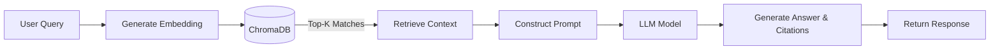

# 🎓 AI Chatbot for University Helpdesk


An intelligent, context-aware university helpdesk chatbot powered by Retrieval-Augmented Generation (RAG). It provides immediate, accurate answers to student queries regarding admissions, courses, facilities, and campus life using a continuously updatable knowledge base.

## 📋 Table of Contents
- [✨ Features](#-features)
- [🏗️ Architecture](#️-architecture)
- [🔄 RAG Pipeline](#-rag-pipeline)
- [🛠️ Tech Stack](#️-tech-stack)
- [📁 Project Structure](#-project-structure)
- [🚀 Getting Started](#-getting-started)
- [💬 Example Questions](#-example-questions)
- [🔑 Default Credentials](#-default-credentials)
- [🔌 API Reference](#-api-reference)
- [🔒 Security](#-security)
- [🧪 Testing](#-testing)
- [📸 Screenshots](#-screenshots)
- [🔮 Future Enhancements](#-future-enhancements)
- [🤝 Contributing](#-contributing)
- [📄 License](#-license)

## ✨ Features

### 🎓 For Students
- **Smart Conversations**: Natural language chat interface with context awareness.
- **Accurate Answers**: Grounded responses cited from official university documents.
- **Interactive UI**: Real-time typing indicators, suggested questions, and Markdown support.
- **Feedback Loop**: Thumbs up/down feedback mechanisms to improve responses.
- **History**: Persistent conversation history.

### 🛡️ For Administrators
- **Dashboard**: High-level analytics on chatbot usage, active users, and popular topics.
- **Knowledge Management**: Upload, view, and delete documents (PDF, DOCX, TXT) instantly.
- **Insights**: View unanswered questions and user feedback.
- **Role-based Access**: Secure JWT authentication ensuring data privacy.

## 🏗️ Architecture

```mermaid
graph TD
    Client[Frontend Client (React)] -->|REST API / HTTP| API[FastAPI Backend]
    
    subgraph Backend
        API --> Auth[JWT Authentication]
        API --> DB[(SQLite / SQLAlchemy)]
        API --> RAG[RAG Engine]
    end
    
    subgraph Data Pipeline
        Admin[Admin Dashboard] -->|Upload Doc| Ingest[Document Ingestion]
        Ingest --> Chroma[(ChromaDB Vector Store)]
        RAG --> Chroma
    end
    
    RAG <--> LLM[OpenAI / LLM API]
```

## 🔄 RAG Pipeline



## 🛠️ Tech Stack

| Category | Technology |
|---|---|
| **Frontend** | React 18, Vite, Tailwind CSS, Axios, Lucide Icons |
| **Backend** | Python 3.11+, FastAPI, SQLAlchemy, Pydantic |
| **AI / RAG** | LangChain, sentence-transformers (all-MiniLM-L6-v2), OpenAI API |
| **Database** | SQLite (Relational), ChromaDB (Vector Search) |
| **Authentication** | JWT (JSON Web Tokens), bcrypt |

## 📁 Project Structure

```text
c:\Users\Gyan Prakash Tiwari\OneDrive\Documents\Software_Engineering\AI_chatbot\
├── frontend/
│   ├── src/
│   │   ├── components/
│   │   ├── pages/
│   │   └── utils/
│   ├── package.json
│   └── vite.config.js
├── backend/
│   ├── main.py
│   ├── api/
│   │   └── routes/
│   ├── core/
│   ├── models/
│   ├── services/
│   │   ├── rag_service.py
│   │   └── auth_service.py
│   ├── scripts/
│   │   └── ingest_documents.py
│   └── requirements.txt
├── data/
│   └── documents/
│       ├── university_info.txt
│       └── faq.txt
└── README.md
```

## 🚀 Getting Started

### Prerequisites
- Python 3.11+
- Node.js 18+
- OpenAI API Key (or compatible LLM API key)

### Step 1: Clone Repository
```bash
git clone https://github.com/yourusername/ai-university-chatbot.git
cd ai-university-chatbot
```

### Step 2: Backend Setup
```bash
cd backend
python -m venv venv
# Windows: venv\Scripts\activate | Mac/Linux: source venv/bin/activate
pip install -r requirements.txt

# Environment variables
cp .env.example .env
# Edit .env and set OPENAI_API_KEY and other variables
```

### Step 3: Ingest Sample Documents
```bash
python -m scripts.ingest_documents
```

### Step 4: Start Backend
```bash
uvicorn main:app --reload --port 8000
```

### Step 5: Frontend Setup
```bash
# In a new terminal
cd frontend
npm install
npm run dev
```

### Step 6: Open Application
Navigate to [http://localhost:5173](http://localhost:5173) in your browser.

## 💬 Example Questions
- *"What are the requirements for the CS graduate program?"*
- *"When does the fall semester start?"*
- *"How do I apply for financial aid?"*
- *"Where is the campus library located and what are its hours?"*

## 🔑 Default Credentials

- **Email:** `admin@university.edu`
- **Password:** `admin123`

*(Note: Change these immediately after your first login in a production environment)*

## 🔌 API Reference

| Endpoint | Method | Description | Auth Required |
|---|---|---|---|
| `/api/chat` | POST | Send a message to the bot | Yes (Student/Admin) |
| `/api/conversations` | GET | List user conversations | Yes |
| `/api/conversations/:id` | GET | Get specific conversation | Yes |
| `/api/conversations/:id` | DELETE | Delete conversation | Yes |
| `/api/auth/register` | POST | Register new user | No |
| `/api/auth/login` | POST | Authenticate and get JWT | No |
| `/api/auth/me` | GET | Get current user data | Yes |
| `/api/feedback` | POST | Submit chat feedback | Yes |
| `/api/admin/documents` | GET | List ingested documents | Yes (Admin) |
| `/api/admin/documents` | POST | Upload a document | Yes (Admin) |
| `/api/admin/documents/:id`| DELETE | Delete a document | Yes (Admin) |
| `/api/admin/analytics` | GET | Get dashboard statistics | Yes (Admin) |
| `/api/admin/unanswered` | GET | Get unanswered questions | Yes (Admin) |
| `/api/health` | GET | Health check endpoint | No |

## 🔒 Security
- Passwords are hashed using bcrypt.
- Stateless authentication using HTTP-only/secure JWTs.
- Role-Based Access Control (RBAC) ensures students cannot access admin routes.
- CORS configured to allow only specific origins.

## 🧪 Testing
```bash
# Backend
cd backend
pytest

# Frontend
cd frontend
npm test
```

## 📸 Screenshots

*(Placeholders for future screenshots)*
- **Chat Interface**: Displaying user query, bot response, and citation.
- **Admin Dashboard**: Displaying key metrics and unanswered questions.
- **Document Management**: Displaying the document upload interface.

## 🔮 Future Enhancements
- Integration with student information systems (SIS).
- Multilingual support.
- Voice input and text-to-speech output.
- Support for more complex tabular data in PDFs.

## 🤝 Contributing
Contributions, issues, and feature requests are welcome! Feel free to check the issues page.

## 📄 License
This project is licensed under the MIT License - see the LICENSE file for details.
