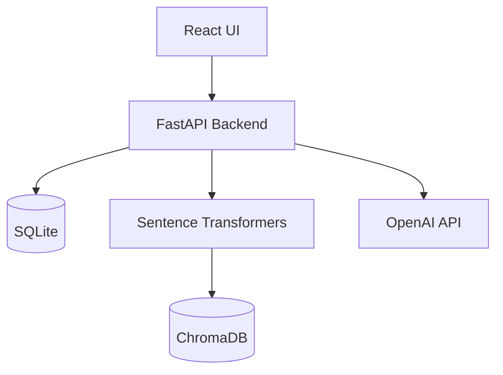
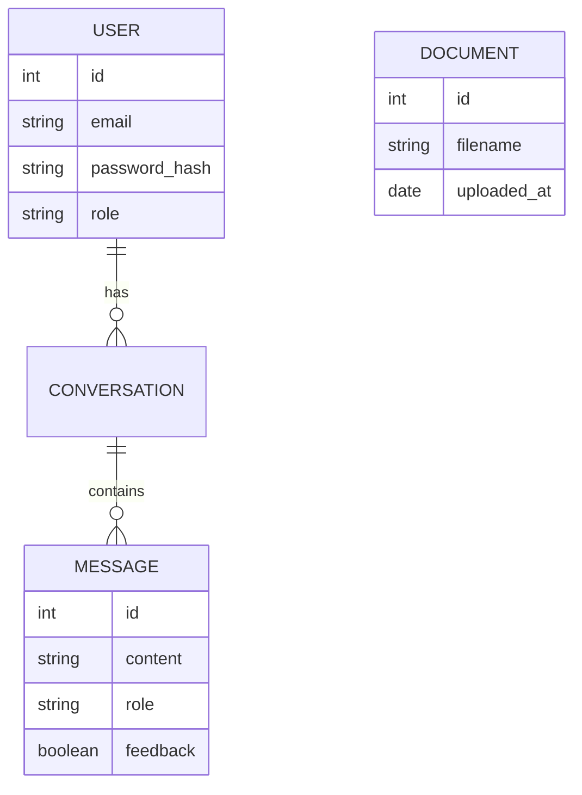

# Software Requirements Specification (SRS)
## AI University Helpdesk Chatbot

### 1. Introduction
This document defines the software requirements for the AI University Helpdesk Chatbot. It provides a detailed description of the system's architecture, functional and non-functional requirements, features, and workflows.

### 2. Purpose
The purpose of this project is to develop an intelligent, context-aware chatbot capable of answering student queries related to university admissions, courses, facilities, and campus life using a Retrieval-Augmented Generation (RAG) approach based on official university documents.

### 3. Scope
The system encompasses a React-based frontend interface for students and administrators, a FastAPI backend, an SQLite database for application data, and a ChromaDB vector database for semantic search. The system will process PDF, DOCX, and TXT files.

### 4. Problem Statement
University helpdesks are often overwhelmed with repetitive queries, leading to slow response times for students. Existing FAQ pages are static and often difficult to navigate.

### 5. Proposed Solution
An AI chatbot that ingests university documents and uses RAG to provide immediate, accurate, and cited answers to student queries through an intuitive chat interface.

### 6. Objectives
- Reduce helpdesk ticket volume by 40%.
- Provide 24/7 instant answers to student queries.
- Ensure all AI responses are grounded in official university data.
- Provide administrators with insights into student queries and missing knowledge.

### 7. Stakeholders
- **Students / Prospective Students:** End-users querying the system.
- **University Administrators:** Managing knowledge base and reviewing analytics.
- **IT Support Team:** System maintenance and deployment.

### 8. User Roles
- **Student (User):** Can chat with the bot, view conversation history, and submit feedback.
- **Administrator:** Can manage documents, view analytics, and monitor unanswered questions.

### 9. Functional Requirements
| Req ID | Requirement | Role |
|---|---|---|
| FR-01 | User registration and authentication via JWT. | All |
| FR-02 | Natural language chat interface with streaming responses. | Student |
| FR-03 | System shall maintain conversation history. | Student |
| FR-04 | User can provide thumbs up/down feedback on responses. | Student |
| FR-05 | Admin can upload PDF, DOCX, TXT documents. | Admin |
| FR-06 | Admin can view and delete uploaded documents. | Admin |
| FR-07 | Admin dashboard showing key usage metrics. | Admin |
| FR-08 | Admin can view unanswered or poorly answered questions. | Admin |

### 10. Non-Functional Requirements
- **NFR-01 (Performance):** Chat responses should begin streaming within 2 seconds.
- **NFR-02 (Scalability):** System should support at least 100 concurrent users.
- **NFR-03 (Security):** All passwords hashed; APIs secured via JWT.
- **NFR-04 (Usability):** Responsive design functioning on mobile and desktop.

### 11. System Features
- RAG-powered query resolution.
- Dynamic document ingestion and vectorization.
- Role-based access control.
- Interactive conversational UI with source citations.

### 12. Use Cases
**Use Case:** Ask Question
- **Actor:** Student
- **Precondition:** Student is logged in.
- **Flow:** Student types question -> System retrieves context -> System generates answer -> Student views answer and citations.
- **Postcondition:** Conversation history is updated.

### 13. System Workflow
1. User logs in.
2. User navigates to chat.
3. User sends message.
4. Backend extracts intent, queries ChromaDB.
5. Relevant chunks passed to LLM.
6. LLM generates grounded response.
7. Response returned to UI.

### 14. System Architecture

### 15. Data Requirements

### 16. AI/RAG Requirements
- Embeddings: `sentence-transformers/all-MiniLM-L6-v2`.
- Vector Store: ChromaDB.
- LLM: OpenAI GPT-3.5/4 or compatible.
- Chunking Strategy: Recursive character text splitting (chunk size 1000, overlap 200).

### 17. Security Requirements
- JWT token expiration (e.g., 24 hours).
- CORS configuration restricting to trusted origins.
- API rate limiting to prevent abuse.

### 18. Error Handling
- Graceful fallback messages if LLM API is down.
- Clear error messages for document upload failures.
- Standardized HTTP error codes (400, 401, 403, 404, 500).

### 19. Performance Requirements
- Vector search latency < 200ms.
- LLM API call timeout set to 15 seconds.

### 20. Testing Requirements
- Unit testing for all utility functions and DB models.
- Integration testing for API endpoints.
- End-to-end (E2E) testing for critical user flows (login, chat).

### 21. Technology Requirements
- Python 3.11+
- Node.js 18+
- React 18
- FastAPI
- SQLite
- ChromaDB

### 22. Assumptions
- The university documents are primarily text-based and in English.
- The LLM provider API remains highly available.

### 23. Constraints
- Hardware limitations for local vector embedding generation (CPU-based).
- Rate limits of the chosen LLM API provider.

### 24. Future Enhancements
- Integration with external university APIs (e.g., live course registration status).
- Support for tabular data extraction from PDFs.
- Multi-lingual support.

### 25. Acceptance Criteria
- System can successfully answer a predefined set of 50 university test questions with >90% accuracy based on ingested documents.
- Authentication flow works flawlessly.
- Admin can successfully upload and delete documents.

### 26. Conclusion
The AI University Helpdesk Chatbot provides a modern, scalable, and intelligent solution to streamline student support, leveraging state-of-the-art RAG technology to ensure accurate and context-aware responses.
