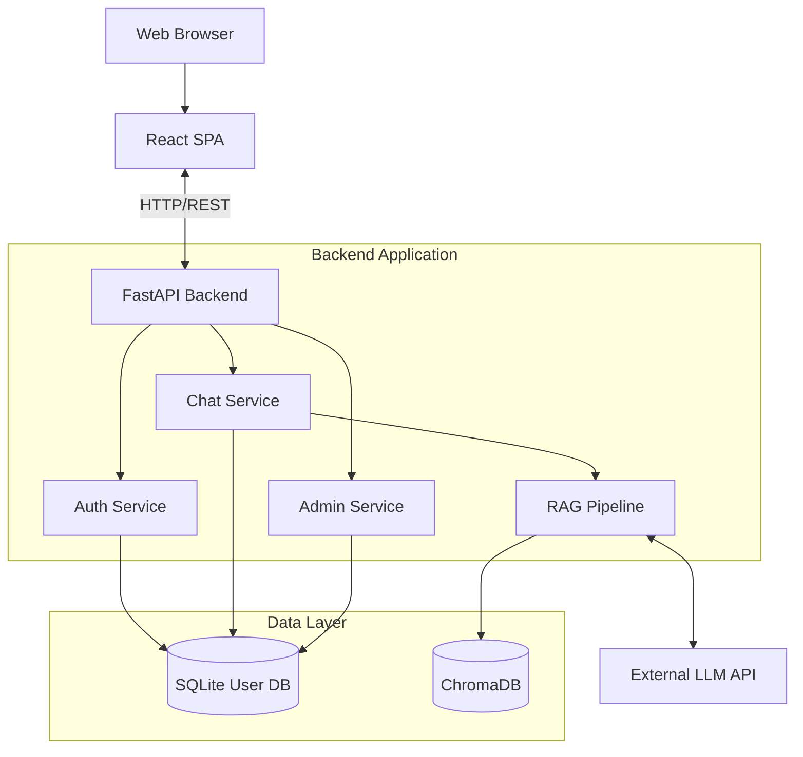
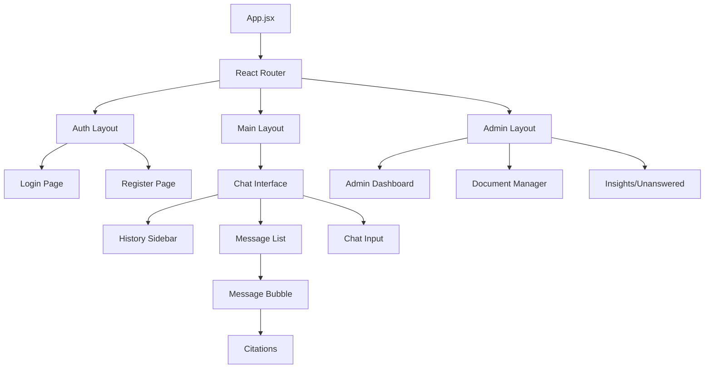
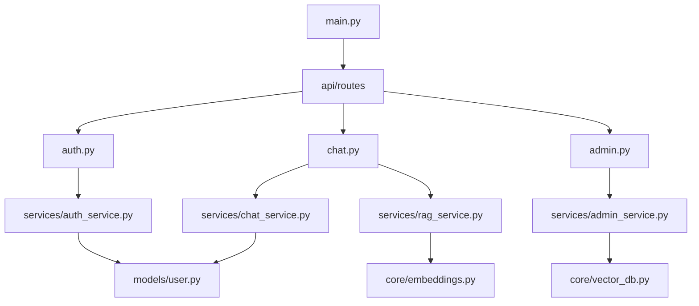
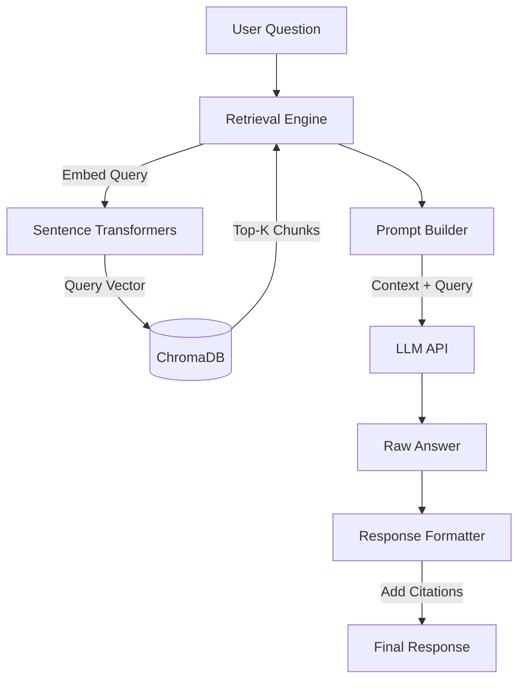
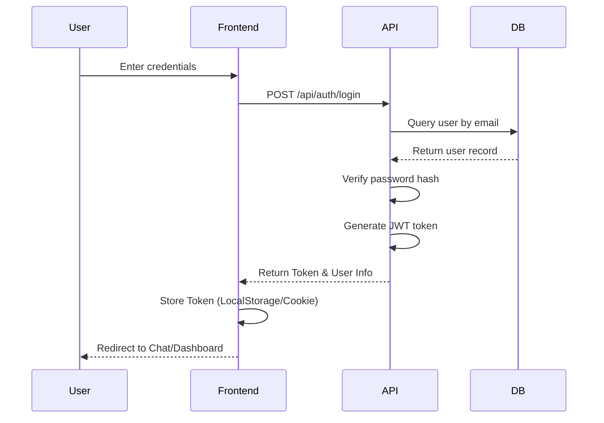
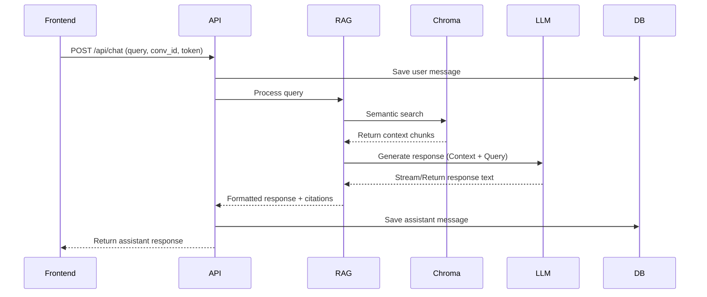
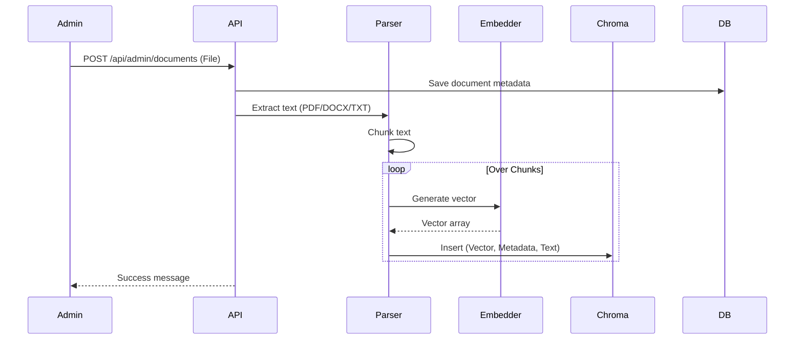

# Architecture Documentation

## 1. High-Level System Architecture

## 2. Frontend Architecture (React)

## 3. Backend Architecture (FastAPI Modules)

## 4. RAG Pipeline Architecture

## 5. Database Schema (ER Diagram)

```mermaid
erDiagram
    User ||--o{ Conversation : has
    Conversation ||--o{ Message : contains
    User {
        int id PK
        string email
        string password_hash
        string role "student/admin"
        datetime created_at
    }
    Conversation {
        int id PK
        int user_id FK
        string title
        datetime created_at
        datetime updated_at
    }
    Message {
        int id PK
        int conversation_id FK
        string role "user/assistant"
        text content
        json citations
        string feedback "up/down/none"
        datetime created_at
    }
    Document {
        int id PK
        string filename
        string file_type
        int file_size
        datetime uploaded_at
    }
```

## 6. Authentication Flow

## 7. Chat Request/Response Flow

## 8. Document Ingestion Flow

